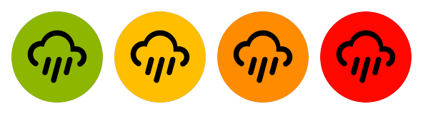

<p align="center"></p>

Turns any [Material Design Icon](https://pictogrammers.com/library/mdi/) into a styled PNG image, on the fly,
for Home Assistant notifications.

Home Assistant notifications can carry a picture, but the `image` field needs a PNG or JPEG URL, and MDI icons
only exist as SVG. This app fetches the icon from the MDI CDN, renders it with the color, background color,
background shape and padding you ask for, and serves the result as a PNG.

```yaml
action: notify.mobile_app_my_phone
data:
  message: "Eső jön."
  data:
    image: "http://homeassistant.local:3000/mdi.png?icon=mdi:weather-pouring&size=128&iconColor=black&bgColor=rgba(255,191,0,1)&bgShape=circle&padding=15"
```

- Size, icon color, background color and background shape per request
- Playground in the sidebar: pick an icon, drag the sliders, copy the URL or the YAML
- In-memory cache, so repeated notifications are served instantly
- Works with the iOS and Android companion apps



## Installation

1. Go to **Settings** > **Apps** and select **Install app**.
2. Open the menu in the top right, select **Repositories**, and add
   `https://github.com/Netesfiu/hass-addons`.
3. Find **Notify Icons**, install it, and start it.

The service listens on port 3000. Use that URL in your notifications, for example
`http://homeassistant.local:3000/mdi.png?icon=mdi:weather-sunny&size=96`.

Full reference for endpoints, styling and troubleshooting: [DOCS.md](DOCS.md).

Part of [Netesfiu's Home Assistant apps](https://github.com/Netesfiu/hass-addons).
